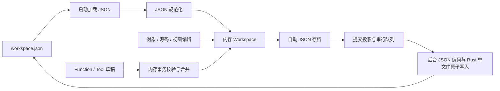

# 架构与代码入口

## 技术与分层

React 19、TypeScript、Vite 构建界面，Tauri 2 提供文件、Python、网络和事件桥。模型和工作流由项目自己的服务执行；当前没有 LangChain/LangGraph 依赖。

| 层 | 目录 / 入口 | 职责 |
| --- | --- | --- |
| 数据模型 | src/model/types.ts、templates.ts、themes.ts | 结构、默认模板、规范化与主题 |
| 纯业务模型 | src/model/markdown.ts、merge.ts、interfaceViews.ts、functions.ts、workflowValues.ts、workflows.ts | 转换、校验、投影、图与类型 |
| 主程序服务 | src/services/storage.ts、scriptHost.ts、functions.ts、tools.ts、workflows.ts | 同步、运行会话和执行 |
| UI | src/ui/AppRoot.tsx、App.tsx 及各页面/组件 | 工作区状态、导航、对象编辑与观察 |
| 桌面桥 | src-tauri/src/lib.rs、functions.rs、model_http.rs、model_stream.rs、workflow_ws.rs | 磁盘、Python、HTTP/SSE、ComfyUI WebSocket |
| 资源与工具 | src/assets、scripts、tests | 本地资源、交付和验证 |

## 工作区与页面

AppRoot 持有 Workspace，并以 latest 引用向 ScriptHost 提供当前 get/update/save。页内编辑将不可变对象提交到工作区，通过 useWorkspaceArchive 自动保存完整 JSON。保存/刷新是明确的导出/导入；限定导出投影不覆盖存档。后台实例计算与渐进导入按稳定身份合并，不能覆盖任务期间的界面编辑。

PageSession 按页面身份保存滚动、视角、搜索、展开等运行期状态。SidebarActions/TopbarActions 复用真实页面动作；TreeDisclosure 分离导航与展开。异步聊天和修改建议保留发起世界/会话 ID，不依赖当前屏幕所在位置。

树移动由 model/treeMoves.ts 校验、ui/useTreeDrag.ts 展示手势与挤位，释放才更新组织。插件文件夹由 pluginFolders.ts 管理，实例/Schema 同级排序共用 SortHandle，批量成员编辑由 bulkEdit.ts 保留各自身份。

## 对象与存储流

model/markdown.ts 负责展示导出，markdownSyntax.ts 提供语法规则，markdownImport.ts 按声明将正文填入 JSON；markdownParser.ts 保留脚本/建议的严格校验模式；model/merge.ts 负责三方合并。services/storage.ts 维护已读写基线、文件快照与串行队列。lib.rs 的 checkpoint_workspace 自动写入唯一 JSON 存档，export_workspace 导出独立文件，read_document_files 仅用于明确导入。background Worker 处理 JSON 加载/规范化、Markdown 解析、预览、差异、序列化与函数/用户 JS Tool 计算；recompute 按目标实例提交。浏览器分支使用 localStorage。

文件结构和竞态规则由 [Markdown 与存储](data/markdown.md) 维护。集合/文件夹只改变逻辑组织，world-index.json 是导出的世界组织清单，Markdown 展示内容，完整身份与引用含义仍由 workspace.json 恢复。

## 世界门面与脚本提交

hostWorldApi.ts 按稳定 ID 解析类、实例和成员；schema/to_value/markdown 按需调用已有转换。不暴露可随意修改的 React 原始对象引用。

scriptHost.beginScript 为一次运行创建 base/draft/open 会话。JS 与编译后的 Flow 在独立 Worker 执行；绑定 Function 在 add 时验证既有 Schema 和写入范围，忽略返回值；Tool 校验可传输返回值，旧独立 Function 保留返回类型兼容。成功后 commit 将草稿与最新世界合并。显式刷新执行的绑定 Function 在同一次状态更新提交新增成员和 functionRuns，主程序 ScriptHost 设置 autoSave:false，成功更新通过 JSON 自动存档，不隐式导出 Markdown。app.storage.save 在 autoSave:false 模式中不触发持久化。

model/functionAppend.ts 根据既有结构构建新增字段、记录来源，并按具体绑定成员和函数 ID 清理失效生成对象。工作区加载规范化及 AppRoot 状态更新都执行绑定协调，避免解绑后的生成对象继续保存。生命周期与兼容边界见 [Function](features/functions.md)。

Python 由 functions.rs 的阻塞线程池启动，读取快照并输出操作日志；services/functions.ts 在主程序门面重放并校验。主程序 JS 没有 Node/Worker 读取路径。脚本等待、取消和非沙箱限制见 [脚本与 Tool](features/tools.md)。

## 工作流执行与编辑

| 部分 | 实现 | 边界 |
| --- | --- | --- |
| Agent/SD 图 | model/workflows.ts、services/workflows.ts | WorkflowGraph 无环依赖、全叶子反向深度优先、返回最后、顺序卡片与独立内部作用域缓存 |
| Function Flow | model/flow.ts、ui/FlowEditor.tsx | FlowGraph 编译为 Function，不混用 Agent 图 Schema |
| 变量和值 | workflowValues.ts、variablePool.ts、workflowBindings.ts、workflowMigration.ts | 信封、严格值、稳定引用、记忆同步和兼容 |
| 编辑事务 | graphEditing.ts、useGraphEditing.ts、useCanvasEditing.ts | 复制、撤销、多选、组拖动、连线 |
| 参数与侧栏 | WorkflowPorts.tsx、VariablePool.tsx、LibraryFolder.tsx | 端口行、输入输出引用、池排序、分类 |
| 拖动形态 | useVariableDrag.ts、DragCardPreview.tsx、useDragCardSize.ts、libraryDrop.ts | 边界变形、同一外壳、正式渲染测量、暴露画布落点 |
| 观察 | services/workflowExecution.ts、comfyEvents.ts | 独立事件副本，不写入图定义 |

runAgent 建立 agentRuntime 根上下文，子调用共享预算、事件与取消，克隆独立工作变量并暂存记忆；AppRoot 和 ModelWorkflowPage 使用 commitAgentMemory 在根成功后统一检查基线并提交。失败/取消丢弃暂存，递归不共享未完成变量。Tool 世界写入有独立会话，不能误当 Agent 记忆的整图事务。

WorkflowEditor 的正式 renderNode 同时用于隐藏尺寸测量。普通变量拖动注册 useCanvasEditing 边界回调，每次移动更新实际节点位置和端口；只在进入列表/其他卡片时暂停普通移动并切换预览，不用独立 DOM transform 留下原位连线。

Agent 图作用域使用 workflowScopes 的叶子目录，services/workflows 的反向深度优先执行器先完成所有普通叶子再执行返回；loop.body 与变量池 Method.graph 各自是独立 DAG，通过共享工作变量联通状态，ANY 控制桥透传。WorkflowEditor 将内部编辑折叠成根图与变量池事务，共用全图历史及每层视角。SD 服务图与 Function Flow 不使用这些 Agent 控制节点。

## 模型与工具适配

llm.ts 负责目录发现、请求体与 assistant 消息、自动工具交流。tools.ts 负责 Schema 校验、用户 JS/HTTP Tool、MCP 风格描述及模型描述转换。builtinTools.ts 定义官方冻结注册表，services/builtinTools.ts 执行官方处理器，workflowTools.ts 与 workflowAgents.ts 分别解析稳定 ID 集合，Agent 能力转换复用 Tool Schema/传输结果，保留类别进行准确分派。

基础 llmBasic 与 toolCalls 在 workflows.ts 分别执行单次模型请求和工具调用。agentExamples.ts 定义可编辑示例。instanceProposals.ts 负责建议事件、原会话定位、确认/拒绝和过期检查；AppRoot 订阅，ChatPage 展示。

modelHttp.ts 非流式调用 model_http.rs；聊天 SSE 经 fetch 或 model_stream.rs 的 reqwest + Tauri Channel，字节经 sse.ts 共用解析器，llm.ts 累积 tool_calls 后校验。chatRuns.ts 合并/迁移过程，ChatExecution 展示调用树，Conversation.modelMessages 保存独立协议。ComfyUI 服务处理原生图及 Tensor，主程序只运行前处理并读取图片结果。workflow_ws.rs 提供桌面事件通道，按 prompt_id 过滤执行观察。

## 投影与交互复用

interfaceViews.ts 统一解析当前 Schema 路径与固定成员路径，生成图、地图所需数据。documents 快照索引和投影缓存避免视角变化重算；App.tsx 的人物关系网拖动使用本地位置预览，释放后提交布局。MapPage.tsx、InterfaceConfigPage.tsx 与 ViewBindingPicker.tsx 复用同一绑定语义。

FieldCard 只维护局部悬停反馈；FieldEditor 对用户成员与函数添加成员使用同一结构呈现；生成成员及其子树使用只读模式。ReadOnlyFunctionValue 是保留的旧结果呈现组件，不是当前绑定函数的显示入口。PickerMenu/portalTheme 处理浮层位置与主题继承。src/main.tsx 单次加载 styles/index.css，家族 CSS 管理皮肤，layouts.css 管理布局；style.css/theme.css 仅保留兼容入口。

## 扩展与维护入口

新增页面先定义来源、身份、存储和复用层；新增变量先定义校验、端口和成员；新增官方 Tool 在程序注册表与处理器扩展，不伪装为用户可编辑脚本。新增写入始终接入既有转换、合并和保存接口。

开发、交付与验证见 [development.md](development.md)；产品未实现方向见 [Planning](../Planning.md#能力边界与维护)。历史代码决策见 [修改日志](changelog/README.md)。

## 数据契约入口

[世界对象](data/world.md)、[JSON 存储](data/json-storage.md)、[Markdown 格式](data/markdown.md)、[视图绑定](data/views.md)、[聊天数据](data/chat.md)、[工作流图和值](data/workflow.md) 维护结构；[持久化功能](features/persistence.md)、[工作流执行](features/workflow-execution.md)、[API 使用](features/api.md) 维护行为。

## 统一运行日志

services/runtimeLog.ts 管理独立运行会话、时间/级别/来源、限量与批量通知；RuntimeLogPanel 使用外部存储订阅，作为覆盖层挂在 AppRoot 下，不改变页面会话布局或 Workspace。main 与 AppRoot 接入主线程 Console、全局异常和界面错误提示；background Worker 回传脚本 Console/堆栈，Python 桥在完成时附带 stdout/stderr。存储、Function/Tool、网络与工作流服务记录生命周期，日志观察不改变业务结果。详见 [运行日志](features/runtime-log.md)。

